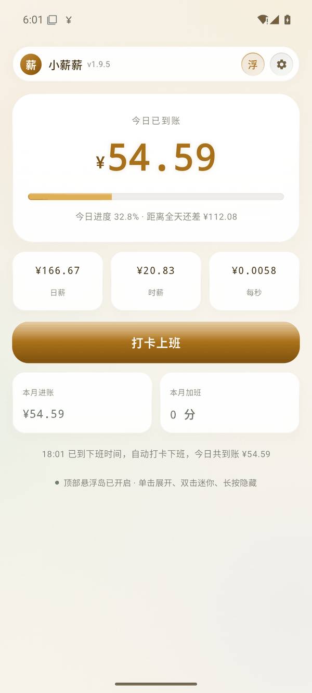
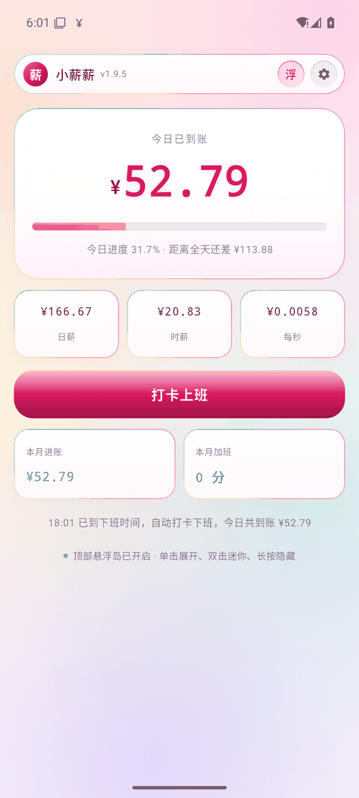
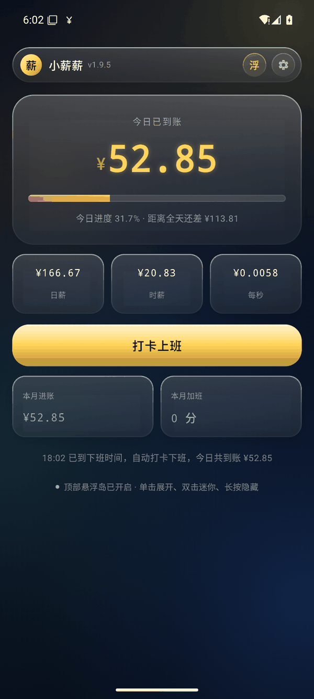
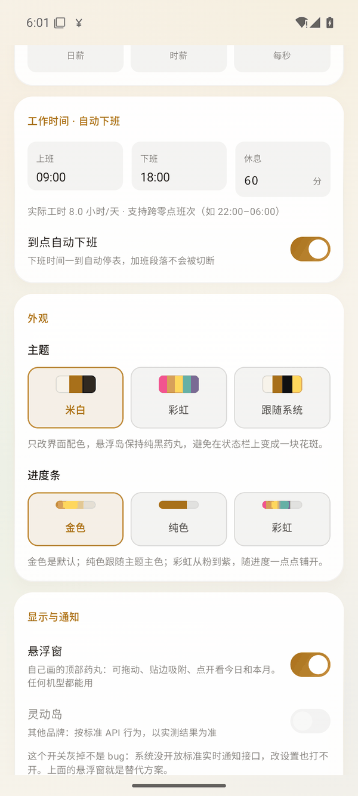

# 小薪薪 · Android 版

> 📦 当前 **v2.7.0**（Build 44，2026-11-08）：悬浮岛 / 通知 / 灵动岛支持 MONEY·DAYS 轮播、配色跟随主题；统计页新增 MONEY / DAYS 双标签。正式签名版，覆盖安装即可升级，数据不丢。包名固定为 `com.haofan.xiaoxinxin`。
> 功能对齐 macOS：首页三模块分页（Your Money 薪酬 / Your Days 倒计时 / Your Days 纪念日）、四套主题、19 组设置、隐私模式、事件管理。
> 从 v1.9.x 及更早版本（包名不同）升级的**需要先卸载旧的**，桌面会短暂出现两个图标。

Mac 版「小薪薪」的手机版。填月薪、打卡，屏幕上实时显示今天已经挣了多少钱。

月薪拆到每一秒，看着数字一格格往上跳。

<p align="center">
  
  
  
</p>

## 装上试试

1. 到 [Releases](https://github.com/terencetian/xiaoxinxin-android/releases) 下载最新的 `xiaoxinxin-android-vX.X.X.apk`
2. 手机上点开安装，允许「安装未知来源应用」
3. 首次打开给两个权限：**通知**（状态栏常驻金额）、**悬浮窗**（顶部药丸）
4. 填月薪 → 打卡上班

> 同一签名的包可以直接覆盖升级，数据不丢。v1.9.2 往后都属于同一签名。

## 三种形态，自己挑

| 形态 | 说明 |
|---|---|
| 📱 应用内首页 | 大号金额 + 进度条 + 日薪 / 时薪 / 每秒三个折算 |
| 💊 顶部悬浮药丸 | 骑在状态栏下沿，可拖动、单击展开、双击迷你、长按隐藏。全机型可用 |
| 🔔 状态栏实况通知 | Android 16 标准 Live Updates，进度条直接长在通知栏里。**仅部分机型** |

两个开关独立（设置 → 显示与通知），可以只开悬浮窗、只开通知，或者都要。

## 机型支持（实测，不是猜的）

系统级实况通知走的是 Android 16 标准接口 `Notification.ProgressStyle` + promoted ongoing。厂商自研的「灵动岛」是白名单制，第三方个人开发者接不进去，所以下面这张表照实写：

| 品牌 / 机型 | 悬浮药丸 | 状态栏实况通知 |
|---|---|---|
| 小米 / 红米（HyperOS 3，红米 K70 Pro 实测） | ✅ | ✅ 生效 |
| OPPO（ColorOS 16） | ✅ | ✅ 官方声明支持 |
| 荣耀 | ✅ | ❌ 自研灵动胶囊，不开放 |
| vivo（X200 Pro 实测） | ✅ | ❌ 私有原子岛，`canPostPromotedNotifications()` 恒 false |
| 华为 | ✅ | ❌ 需 ArkTS 元服务，Java 侧无入口 |
| 其他 Android 8.0+ | ✅ | 按标准 API 行为，以实测为准 |

**开关灰掉不是 bug**：系统没开标准实况接口时，设置页那个开关会置灰并写明原因。顶部悬浮药丸就是兜底方案，任何机型都能用。

## 功能

| 功能 | 说明 |
|---|---|
| 🕐 打卡计时 | 上班打卡后按秒累计，下班结算 |
| 🌅 到点自动上班 | 上班时间一到自动打卡计费（系统闹钟触发，App 不开也生效；重启后可用「开机自启动」恢复） |
| ⏰ 到点自动下班 | 到计划下班时间自动停表，加班段不会被切断 |
| 🌙 加班计费 | 过点再打卡识别为加班，累计加班时长 |
| 🌅 跨天重置 | 跨零点班次（如 22:00–06:00）正确切分 |
| 📅 工作日自动算 | 按国办法定节假日推算当月工作日，含调休补班 |
| 📈 统计页 | 本周 / 本月 / 上月 / 本年四种口径：累计进账、累计加班、出勤天数、日均、同比上周，带柱状图与逐日明细 |
| 📋 流水明细 | 按日期范围查每日到账，支持补记与删除 |
| 🎨 四套主题 | 米白 / 薄荷绿 / 天蓝（默认）/ 索尼 30 周年，与 macOS 2.0 一一对应 |
| 🔒 隐私模式 | 工资数字改为百分比进度，4 位 PIN 解锁，60 秒后自动恢复 |
| ⏳ Your Days · 倒计时 | 自定义目标日（含时刻），按秒算进度、按自然日算剩余，事件可增删改切换 |
| 💞 Your Days · 纪念日 | 累计时长（X 年 Y 月 Z 天）+ 累计天数，事件管理同上 |
| 🧩 首页布局 | 三张进度卡可单独显隐（至少留一张），卡片点开进对应二级页 |
| 🌈 进度条三档 | 金色（默认）/ 纯色（跟随主色）/ 彩虹 |
| 💊 悬浮药丸 | 三态形变、拖动吸附、顶部保护栏（滑不进状态栏） |
| 🔔 实况通知 | 通知栏进度条，每 3 秒刷新 |
| 💾 本地存储 | 完全离线，不联网、无统计、无上传 |

<p align="center">
  
</p>

## 和 Mac 版的差异

| 能力 | Android | macOS |
|---|---|---|
| 屏幕悬浮窗 | ✅ 顶部药丸 | ✅ 悬浮小窗 |
| 状态栏常驻 | ✅ 通知栏 / 实况通知 | ✅ 菜单栏 |
| 桌面小组件 | ⬜ 待做 | ✅ |
| 贴边收纳 | ❌ 系统不支持 | ✅ |
| 图标吸色 | ⬜ 待做 | ✅ |

数据各端独立，不互通（`EarnState.deviceId` 已预留，日后接同步不用改算法）。

## 自己编

需要 JDK 17 与 Android SDK（compileSdk 36、build-tools 35.0.0）。

```bash
# debug 包（尝鲜版就是它：debug 构建，但包名是正式包名 com.haofan.xiaoxinxin）
./gradlew assembleDebug

# 正式签名包（需 keystore.properties）
./gradlew assembleRelease

# 单测（逻辑层，跟 Swift 版断言一一对应）
./gradlew testDebugUnitTest
```

没有 Gradle 可以用外置的：`$HOME/dev-tools/gradle-8.11.1/bin/gradle assembleRelease`

## 签名

`keystore.properties`（不入库）：

```
storeFile=keystore/xiaoxinxin.jks
storePassword=****
keyAlias=xiaoxinxin
keyPassword=****
```

**keystore 与密码务必另存备份**。丢了就没法再给已安装用户升级，只能换包名重来。

## 归档

```bash
./tools/archive_apk.sh 1.9.9 --rebuild
```

会校验 APK 内的 versionName 与传入版本一致（不符直接中止），复制到
`~/Documents/小薪薪-发布版本/v<版本>/`，打印 sha256，并在 `版本索引.md` 追加一行。

## 结构

```
app/src/main/java/com/haofan/xiaoxinxin/
├── core/       纯逻辑层，无 Android 依赖，可单测
│   ├── Logic.kt       工时 / 节假日 / 日期校验 / 费率
│   ├── EarnState.kt   状态与金额计算（金额由时间戳现算，不靠定时器累加）
│   ├── EarnRepo.kt    持久化 + 打卡 / 跨天 / 自动下班 / 流水
│   ├── AutoPunch.kt   到点自动上班（AlarmManager 精确闹钟）+ 开机 / 升级后恢复
│   ├── Stats.kt       统计聚合（本周 / 本月 / 上月 / 本年）
│   ├── LiveUpdate.kt  实况通知（ProgressStyle + 短文案）
│   └── IslandDoctor.kt 系统岛能力体检 + 品牌实测结论
├── ui/         Compose 界面（Liquid Glass 风格，四套 Palette）
│   ├── AppShell.kt      三 Tab 骨架：主页 / 统计 / 设置（真实底部栏，不遮挡内容）
│   ├── GlassTabBar.kt   玻璃底栏（金描边分层）
│   ├── HomeScreen.kt    首页三进度卡（可显隐）
│   ├── SalaryScreen.kt / CountdownScreen.kt / RecordDayScreen.kt   三个二级页
│   ├── StatsScreen.kt / SettingsScreen.kt（19 组可折叠设置）
│   ├── Theme.kt         四套主题 Palette + 派生配色
│   └── Components.kt    通用卡片 / 按钮 / 输入
└── floatx/     悬浮窗前台服务（药丸岛自绘、三态形变、拖动吸附）
```

---

**完全离线**：不联网、不统计、无上传，所有数据只存本机。
